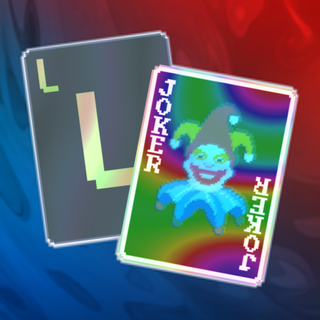
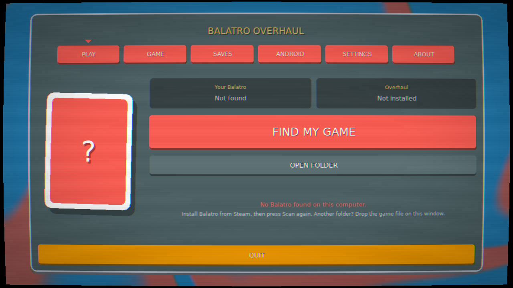
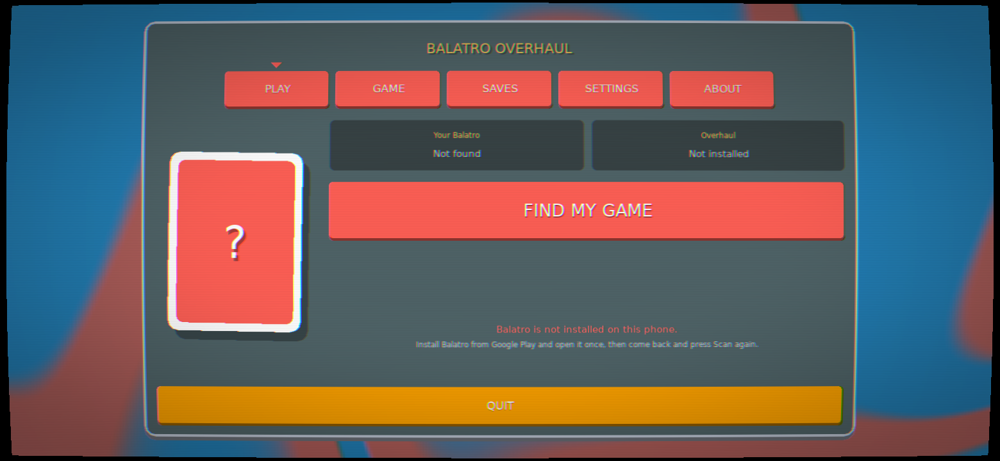
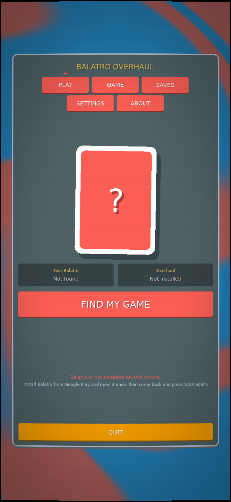
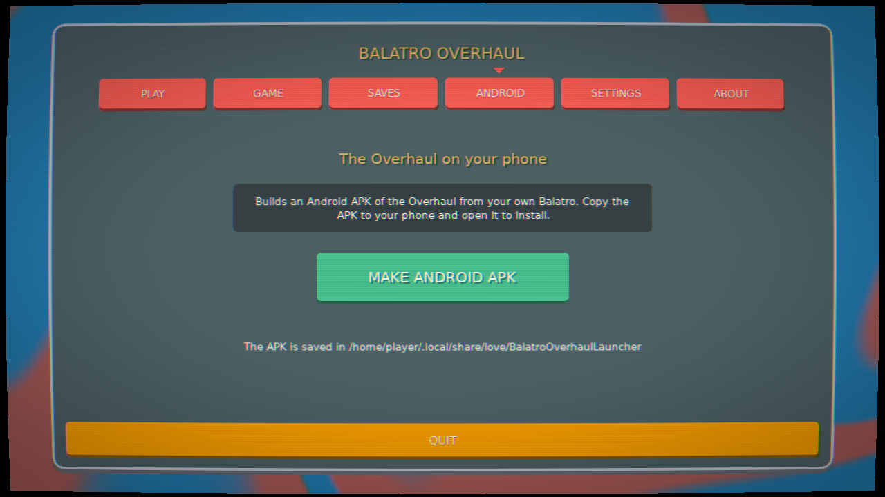

<div align="center">



# Balatro Overhaul

**A big fan mod for [Balatro](https://www.playbalatro.com/): online multiplayer, new stakes, a casino, a joker maker, mod support, and a lot more.**

[](https://github.com/JupiterianSoul/Balatro-Overhaul/releases/latest)
[](https://github.com/JupiterianSoul/Balatro-Overhaul/releases)


[**Download**](https://github.com/JupiterianSoul/Balatro-Overhaul/releases/latest) &nbsp;·&nbsp; [Install guide](#install) &nbsp;·&nbsp; [Changelog](CHANGELOG.md) &nbsp;·&nbsp; [Report a bug](https://github.com/JupiterianSoul/Balatro-Overhaul/issues) &nbsp;·&nbsp; [Patreon](https://www.patreon.com/cw/JupiterianSoul)

</div>

> [!IMPORTANT]
> You need to own Balatro. The downloads here don't contain the game, the launcher builds the mod from your own copy.

<div align="center">


</div>

## What's in it

**Multiplayer** is the big one. Play 1v1 or in parties of up to 8, with friends or random people, casual or ranked. In most modes you both play the same boss blind and the lower score loses a life, but there's also Battle Royale, co-op raids, races, and Switcheroo, where mid-match you swap your whole run with your opponent.

**The Forge** lets you make your own jokers. You choose what they do, draw them pixel by pixel, and share them online. It does decks, tarots, vouchers and the rest too.

**The Casino** is where everything outside of runs lives: quests, cosmetics, the Forge, and an arcade with a dozen minigames.

There's also 4 new stakes after Gold, custom runs, daily runs, 242 achievements, a Hand Optimizer that finds your best play, a mod workshop that works on Android, and the whole thing is in English, French and Spanish.

<details>
<summary><b>The full list</b></summary>

#### Multiplayer

From the title screen you can do a Quick Match against a random person, make a room (public or private) and send the code to your friends, or browse open rooms.

**1v1 modes**
- **Rivals**: normal run, but from ante 2 every boss blind is a PvP blind. You both play the same blind, the higher score wins, the loser loses a life.
- **FaceOff**: same thing, but every blind is PvP.
- **Ascension**: no PvP at all, whoever gets the furthest wins.
- **Switcheroo**: at some point you both get ready, there's a 3 second countdown and you swap everything (jokers, deck, money...) except your lives.

**Party modes (up to 8 players)**
- **Battle Royale**: lowest score on each PvP blind loses a life, last one standing wins.
- **Teams**: scores of a team add up and the team shares its lives.
- **Co-op Raid**: everyone works together to beat one big shared boss.
- **Race**: first one to reach the target ante wins.

**Ranked** always uses the same fixed rules. You win RP, you lose RP, and you climb from Stone to Bronze, Silver, Gold, Platinum, Foiled, Holographic, Polychromed, Negative and finally TRUE JIMBO. Seasons give cosmetics (badges, titles, sleeves, frames...). It's separate from your normal level.

**Rooms** let the host change pretty much everything: lives, which ante PvP starts at, the final ante, the deck, the stake, banned cards, and presets like Classic, Balanced, Vanilla, Sprint or Chaos. Some cards are reworked for multiplayer (you can see which ones in Collection > Reworks), and there are jokers, decks and blinds that only exist in multiplayer.

Also: friends list and DMs, lobby chat that keeps working during the run, emotes, mute/report, games speed up to 4x, and if someone disconnects their seat is kept for 15 minutes so they can rejoin. Every match is saved as a replay (Profile > History) and you can spectate other games live.

Modded rooms are in beta: the room shows what mods it uses and installs the missing ones when you join.

#### Solo

- **Custom runs**: pick your own hands, discards, hand size, money, slots, win ante, deck size (1 to 208 cards), starting jokers, what can show up in the shop, endless mode...
- **Daily and weekly runs**: same seed for everyone, with a leaderboard.
- **4 new stakes after Gold**:
  - Chaos: booster packs have one less choice
  - Apocalypse: boss blinds get an extra effect
  - Oblivion: one random joker slot is disabled each round
  - Transcendent: every boss is a finisher boss
- **Cheats**: turn them on when you start a run and you get a button you can drag anywhere, with money, hands, god mode, any joker, any card, any voucher, hand levels... Cheated runs don't give XP, obviously.
- **Boss Practice** to train against a specific boss, a **Seed Library**, and **speedruns**.
- **Badges**: beat a boss 10 times and you unlock its badge. Equip it and that boss's effect is turned off for your next run.
- A few balance changes: Wild Cards can't be debuffed by bosses, Matador gives $2 per discard during a boss, and Blue Stake works differently (shop prices go up $1 per ante cleared and rerolls by $2).

#### Progression

You get XP from playing (hands, antes, bosses, wins, more on higher stakes). There are 100 levels across 7 ranks, from Novice to Legend, and every level gives Balacoin.

On top of that there are 4 daily quests (you can swap one for free), 4 weekly ones, longer "Journeys" that go in stages, and 242 achievements with popups.

#### The Casino

The Casino is a little map you open from the title screen. Each building is a feature:

- **Tavern**: quests and your run history
- **Market**: spend Balacoin on packs of cosmetics. The odds are all shown in the Odds tab, things you don't have yet are 3x more likely, and duplicates turn back into Balacoin. You get a Legendary at least every 40.
- **Tailor**: equip your stuff. Card backs, table, colours (23 palettes + Polychromatic), profile icon, title, shine, and outfits for Jimbo.
- **The Forge**: make your own jokers. You pick what they do, draw them pixel by pixel, and you can share them online and download other people's. It also does tarots, planets, spectrals, vouchers, decks, enhancements, editions and boosters. The **Deck Creator** is here too.
- **Library**: the Seed Library
- **Training Grounds**: Boss Practice
- **Arcade**: minigames. Blackjack, a slot machine, Poker, High or Low, Find the Ace, Name the Hand, Joker Memory, Whack-a-Joker, Jimbo Run, Beat the Blind, and Jimbo Jam (a rhythm game that makes charts out of your own songs from the Jukebox).
- **Racetrack**: speedruns

#### Helpers

All of these can be turned off in Settings.

- **Hand Optimizer**: tries every hand you could play and scores them with the real game rules (jokers, levels, boss, everything). It shows the best one, a button to select it, and the top 5. If luck is involved it gives a range.
- **Jimbo Comments**: Jimbo reacts to what's going on in your run (big hands, close calls, rare jokers, PvP...). You can choose how often he talks.
- **Hologram**: the new mascot. The first time you see something new, Hologram explains it. You can skip it.
- **Jukebox**: pick the music, or add your own.
- Stats for your solo and multiplayer games.
- A bunch of small quality of life stuff: faster pack opening, hotkeys, settings search, sell total, the game pauses when you tab out...

#### Mods

The game has two modes, switched from the title screen: **Normal** (no mods ever load) and **Modded** (your mods load). Each one has its own 3 profiles, so mods can't mess up your main save.

Most Steamodded and Lovely mods work, on Android too. There's a mods menu to turn them on/off, configure and update them, and a **Workshop** to browse and install hundreds of mods from the Balatro Mod Index without leaving the game. You can also just drop a mod `.zip` in your Downloads folder. If a mod crashes the game at startup, it gets turned off next time and the game tells you which one it was.

#### Everything else

- Works with touch, controller and keyboard/mouse, on PC and phone. On a phone in portrait mode the hand goes in the middle of the screen.
- A performance mode for slow phones or big modpacks like Cryptid.
- The whole game is in English, French and Spanish.

For what changed in each version, see the [changelog](CHANGELOG.md).

</details>

## Install

Get the file for your device from the [latest release](https://github.com/JupiterianSoul/Balatro-Overhaul/releases/latest):

| Device | File | You need |
|---|---|---|
| Windows | `BalatroOverhaulLauncher-2.0-windows-x64.zip` | Balatro on Steam |
| macOS | `BalatroOverhaulLauncher-2.0-macos.zip` | Balatro on Steam |
| Linux | `BalatroOverhaulLauncher-2.0-linux-x86_64.tar.gz` | Balatro on Steam |
| Android | `BalatroOverhaulLauncher-2.0-android.apk` | Balatro from Google Play |

It's the same launcher everywhere: it finds your Balatro, you press **Install**, then **Play**.

<details open>
<summary><b>Windows</b></summary>

Unzip it anywhere and open `Balatro Overhaul Launcher.exe`. Windows will probably warn you about an unknown publisher, click **More info** then **Run anyway**.

If Balatro is on Steam the launcher finds it by itself. If not, drag `Balatro.exe` onto the window.

The first time, it asks if you want to keep your Balatro progress or start fresh. Either way both saves get backed up, and your real Balatro save is never touched. Then press **Install** and **Play**. It also adds shortcuts to your desktop, Start menu and Steam.

</details>

<details>
<summary><b>macOS</b></summary>

Unzip and put `Balatro Overhaul Launcher.app` in Applications. The app isn't signed by Apple, so the first time you have to right click it, **Open**, then **Open** again. If macOS says it's damaged, run this in Terminal:

```
xattr -cr "/Applications/Balatro Overhaul Launcher.app"
```

After that it works like on Windows.

</details>

<details>
<summary><b>Linux</b></summary>

Unpack it and run `./balatro-overhaul-launcher`. It finds Balatro in your Steam library (Flatpak Steam too), and adds the game and the launcher to your app menu after the install.

</details>

<details>
<summary><b>Android</b></summary>

You need Balatro from Google Play, opened at least once.

Download the `.apk` on your phone and open it. Android will ask you to allow installs from your browser or file manager. Then open **Overhaul Launcher**, press **Install** (takes about a minute) and **Play**.

It's the same launcher as on PC, so you also get the Saves tab to export or import your saves.

On Samsung, turn off Auto Blocker while you install (Settings > Security and privacy). If Play Protect complains, tap **More details** then **Install anyway**.

<p align="center"></p>

</details>

<details>
<summary><b>Android, if you only have Balatro on Steam</b></summary>

The PC launcher has an **Android** tab that makes the phone app from your Steam copy. Install the Overhaul on your PC first, then press **Make Android APK**, copy the file to your phone and install it.

<p align="center"></p>

</details>

No iPhone, sorry.

## Updates

When there's a new version, the game tells you on the title screen and installs it. The launcher does too. Your saves stay where they are. For multiplayer, everyone needs to be on the same version.

## Saves

The Overhaul has its own saves, separate from Balatro's.

- To move your save to another device, use **Export my save** (in Settings > Account, or the launcher's Saves tab). It makes one `.zip` you can import on the other side.
- Before any import, your current save is backed up.
- Exports don't include your settings or your online key, so you can share them.

## Online

Multiplayer runs on my own server, not LocalThunk's or Playstack's.

Your account is just your name and a random key stored on your device. Crash reports are on by default: they send the error, the version, your platform and your mod list, nothing personal, and you can turn them off in Settings > Account. No ads, no tracking.

If you want your account deleted, open an issue. The server is free, so it can go down from time to time.

## Bugs

Open an [issue](https://github.com/JupiterianSoul/Balatro-Overhaul/issues) and tell me what happened, on which device, and the version (bottom right of the title screen).

## Support

It's free and it'll stay free. If you want to help pay for the server there's a [Patreon](https://www.patreon.com/cw/JupiterianSoul), no pressure.

## License

All rights reserved. You can download it, play it and share the link, but you can't reuse, modify or redistribute the code. Full text in [LICENSE](LICENSE). The open source parts it uses keep their own licenses, see [LICENSES](LICENSES).

## Credits

Made by JupiterianSoul. Thanks to Samlegeek63 and Monoceros.

Uses LÖVE 11.5, Steamodded, nativefs, json.lua and the Balatro Mod Index. Thanks to Lovely Injector, and to Balatro Multiplayer, which did multiplayer first.

This is a fan mod. It's not made or endorsed by LocalThunk or Playstack, and Balatro belongs to them. Go buy it.
